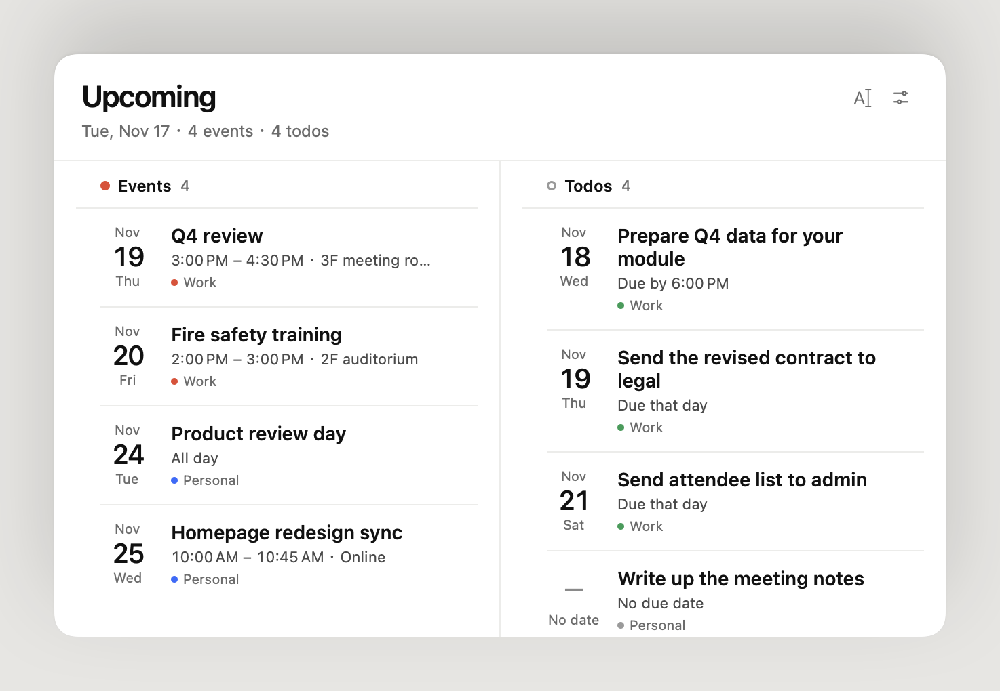
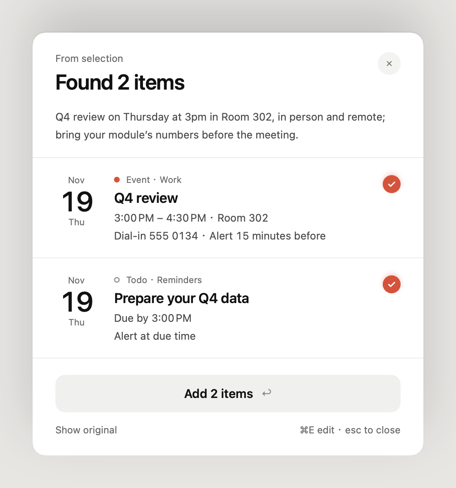
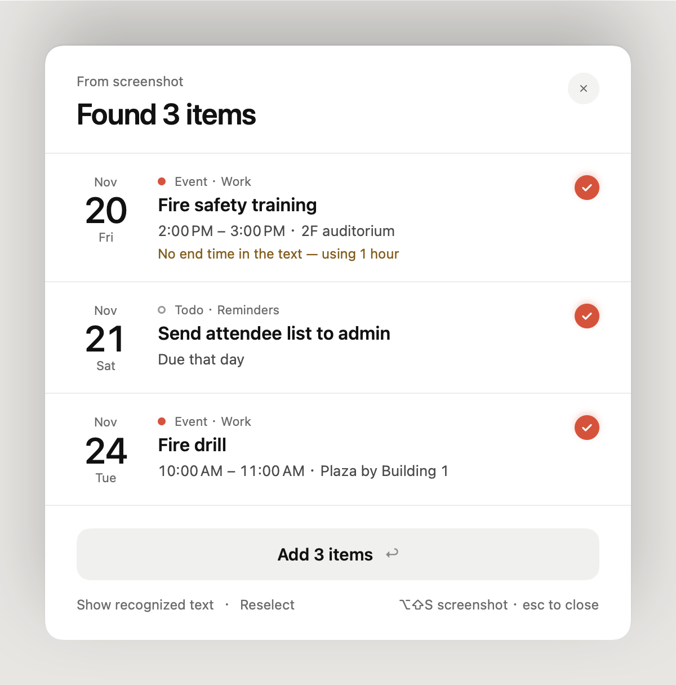
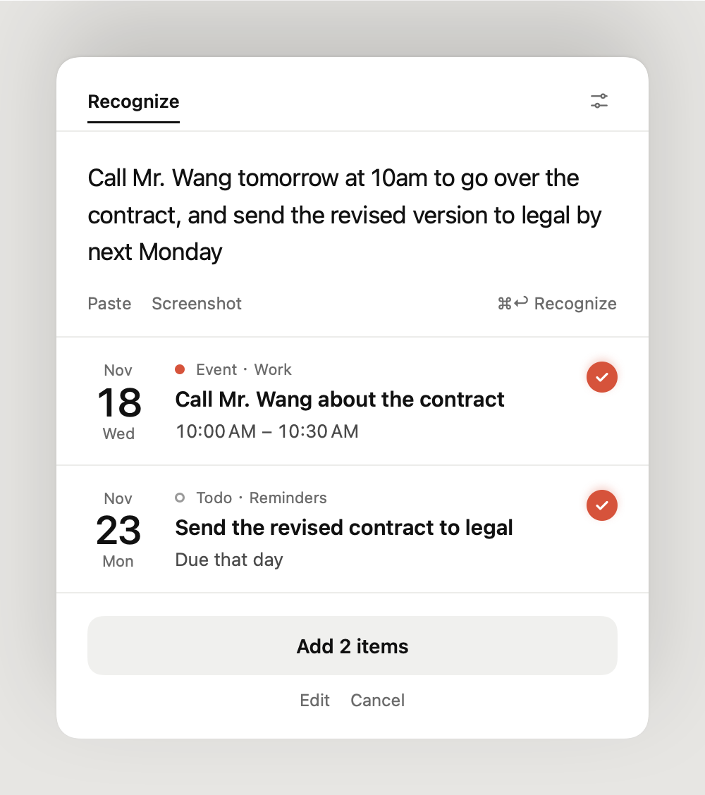
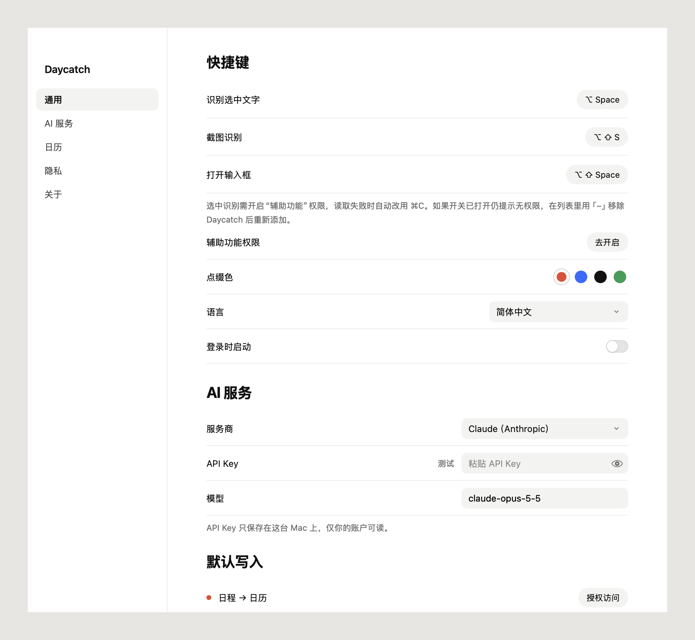

# Daycatch

**English** · [简体中文](README.zh-CN.md)

A macOS menu bar app that turns text or a screenshot into calendar events and reminders. Select a message, paste a chat log, or capture a screen region — Daycatch extracts the dates, times, and tasks with an AI model of your choice, shows you what it found, and writes the confirmed items into **Calendar** and **Reminders** with one keystroke.

<p align="center">
  
</p>

No more copying “Thursday 3pm, Q4 review, Room 302” out of Slack or iMessage and into two different apps. Nothing is written until you confirm it, and everything written can be undone.

## Why another one

- **Three ways in, one review screen.** Selected text (`⌥Space`), a screenshot (`⌥⇧S`), or a pasted message (`⌥⇧Space`).
- **You stay in control.** Every item can be unchecked or edited inline before it is written. Fields the model guessed (rather than read from the text) are clearly marked.
- **One shortcut to write, one click to undo.** `↩` adds the checked items; the toast that follows has an **Undo** button that deletes exactly what was just created.
- **Screenshots never leave your Mac.** OCR runs locally via Vision — only the recognized text is sent to your AI provider.
- **Bring your own model.** Claude, OpenAI, DeepSeek, Qwen, or any OpenAI-compatible endpoint, with your own API key.

## Features

| | |
|---|---|
| **Agenda panel** | Click the menu bar icon to see upcoming events and open reminders side by side, sorted by time. Reads Calendar and Reminders read-only. |
| **Selection capture** | `⌥Space` reads the current selection via the Accessibility API, falling back to a simulated `⌘C` when that fails. |
| **Screenshot capture** | `⌥⇧S` lets you drag a region, runs local Vision OCR, and extracts from the recognized text. |
| **Manual input** | `⌥⇧Space` or the panel's input button. Paste anything, then `⌘↩` to extract. |
| **Inline editing** | `⌘E` edits a result in place — title, date, time, alarm, and destination list. |
| **Inference markers** | Missing end times, vague "afternoon", guessed locations — all flagged, so a guess never looks like a fact. |
| **Undo** | The post-write toast deletes the calendar events and reminders it just created. |
| **Two interface languages** | 简体中文 or English, switchable in **Settings → General → Language**. Follows the system language by default, and the AI prompt follows the interface language too. |

<p align="center">
  
  
  
</p>

## Requirements

- macOS 14 (Sonoma) or later
- Xcode 15 or later
- [XcodeGen](https://github.com/yonaskolb/XcodeGen) — `brew install xcodegen`
- An API key for one of the supported AI providers

## Install

```sh
brew trust luckyabner/daycatch                          # Homebrew requires trusting third-party taps
brew install --cask luckyabner/daycatch/daycatch
```

You can also build from source — see below.

## Updates

Daycatch updates itself with [Sparkle](https://sparkle-project.org): it checks GitHub Releases once every 24 hours in the background, and when a new version exists a card appears in the corner — click **Update** to download, verify the signature, replace the app, and relaunch.
You can also check by hand: **Settings → About → Check now**, or right-click the menu bar icon → **Check for Updates…**.

Your settings and granted system permissions survive updates. See [docs/updates.md](docs/updates.md) for the release process and signing keys.

## Build and run

```sh
git clone https://github.com/luckyabner/daycatch.git
cd daycatch

make build      # generate Daycatch.xcodeproj and build Debug
make test       # run unit tests (offline, no app launch)
make run        # build, then launch — a calendar icon appears in the menu bar
make snapshot   # render every screen with sample data to build/snapshots/
make release VERSION=0.2.0   # publish: zip + signature + appcast + GitHub Release (see docs/updates.md)
```

`Daycatch.xcodeproj` is generated from `project.yml` — don't edit it by hand.

On first launch, open **Settings → AI service**, pick a provider, paste your API key and model, and use the **Test** button to verify the connection.

> **Launch it with `make run` or `open build/Build/Products/Debug/Daycatch.app`.** Running `Contents/MacOS/Daycatch` from a terminal makes macOS attribute permissions to your terminal instead of the app. Builds made directly in Xcode or with plain `xcodebuild` are ad-hoc signed, so permissions are revoked on every rebuild — `make build` re-signs with a local self-signed certificate to avoid that.

## Usage

| Entry point | Default shortcut | What it does |
|---|---|---|
| Agenda panel | Click the menu bar icon | Events on the left, todos on the right, filling the panel from nearest to farthest. A column is hidden when it is empty. Extract and Settings live in the top-right. |
| Selection capture | `⌥Space` | Reads the selected text; results appear in a floating panel next to the cursor. |
| Screenshot capture | `⌥⇧S` | Drag a region, OCR locally with Vision, then extract. The image is never uploaded. |
| Manual input | `⌥⇧Space` / panel button | Paste text, then `⌘↩` to extract. |

In the results panel: `↩` adds the checked items, `⌘E` edits a row inline, `esc` closes. Right-click the menu bar icon for Settings or Quit. Shortcuts, accent color, and launch-at-login are configurable in Settings.

## Supported AI providers

| Provider | Default endpoint | Default model |
|---|---|---|
| Claude (Anthropic) | `https://api.anthropic.com` | `claude-opus-5-5` |
| OpenAI | `https://api.openai.com/v1` | `gpt-5-mini` |
| DeepSeek | `https://api.deepseek.com/v1` | `deepseek-chat` |
| Qwen (Alibaba Cloud) | `https://dashscope.aliyuncs.com/compatible-mode/v1` | `qwen-plus` |
| Custom | any OpenAI-compatible base URL | your choice |

Anthropic uses the native Messages API; every other provider goes through the OpenAI-compatible chat completions API. Base URL and model are both editable, so other compatible services (local proxies, gateways, self-hosted models) work too. Input is capped at 20,000 characters.

<p align="center">
  
</p>

## Permissions

| Permission | Used for | Requested when |
|---|---|---|
| Accessibility | Reading the selected text, simulating `⌘C` as a fallback, and reliably capturing `⌥Space` on macOS 15 | First `⌥Space` |
| Screen Recording | Screenshot capture | First `⌥⇧S` |
| Calendars / Reminders (full access) | Agenda panel, writing items, and deleting them on undo | First menu bar click, or the first **Add** |

There is no Developer ID certificate. `make build` creates a local self-signed certificate via `scripts/sign.sh` (kept in `.signing/`, it does not touch your login keychain). The signing identity is derived from the bundle ID plus the certificate, so **already-granted permissions survive rebuilds**. Delete `.signing/` and you will be asked to grant them once more.

## Privacy

- Your text or OCR output is sent only to the AI provider you configure, using your key. There is no Daycatch server and no telemetry.
- Screenshots are processed on-device and never uploaded.
- The API key is **not** stored in the Keychain (Keychain prompts would reappear whenever the signature changes). It lives in `~/Library/Application Support/com.luckyabner.daycatch/credentials.json` with mode `0600`, readable only by your user account.
- Calendar and Reminders access is read-only except when you confirm an add or an undo.

## Project structure

```
Daycatch/
  App/          Entry point, AppController (wires the flows), floating panels, menu bar item, settings window
  Agenda/       Agenda read model (read-only EventKit), two-column state
  UI/           Design tokens, results panel ①②, menu bar popover ③, agenda panel, toast, settings ④
  AI/           AIProvider protocol, Claude and OpenAI-compatible clients, prompts, ExtractionService
  Model/        Item model, AI JSON parsing, date parsing, display formatting
  Recognition/  Selection reader (AX + ⌘C fallback), screenshot + Vision OCR, permissions
  Calendar/     EventKit writes and undo
  Settings/     UserDefaults settings, API key file store
  Hotkeys/      Global hotkeys (Carbon + CGEventTap)
DaycatchTests/  Unit tests (fake AI responses and HTTP)
Spikes/         Minimal probes for system APIs
docs/           Screenshots
```

## Development

```sh
make test       # unit tests, no network, no app launch
make snapshot   # regenerate docs-ready screenshots at build/snapshots/
```

The test target compiles the pure-logic sources (`Model`, `AI`, `Shortcut`, `CredentialStore`) directly instead of hosting the app, so tests never launch the menu bar agent. AI calls are faked at the HTTP layer, so the suite runs offline.

## Known limitations

- The UI is currently **Simplified Chinese only**. Localization PRs are very welcome.
- macOS only; no iOS companion.
- One API key per provider, stored locally in a plain file (see Privacy).
- Not notarized — it is signed with a project-local self-signed certificate, so install it with Homebrew (see Install) rather than a browser download.

## Contributing

Issues and pull requests are welcome. For anything larger than a bug fix, please open an issue first so we can agree on the direction. Before sending a PR, run `make test` and `make build`.

## License

[MIT](LICENSE) © 2026 luckyabner

Daycatch is free to use, modify, and distribute. If you ship a modified version, keep the copyright notice and license text.
