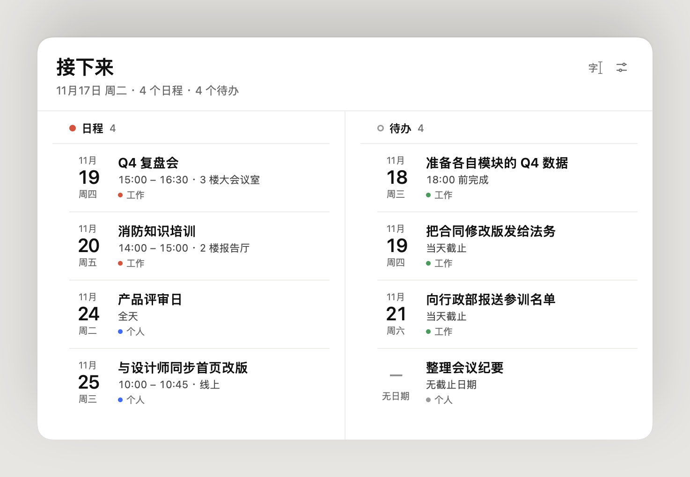
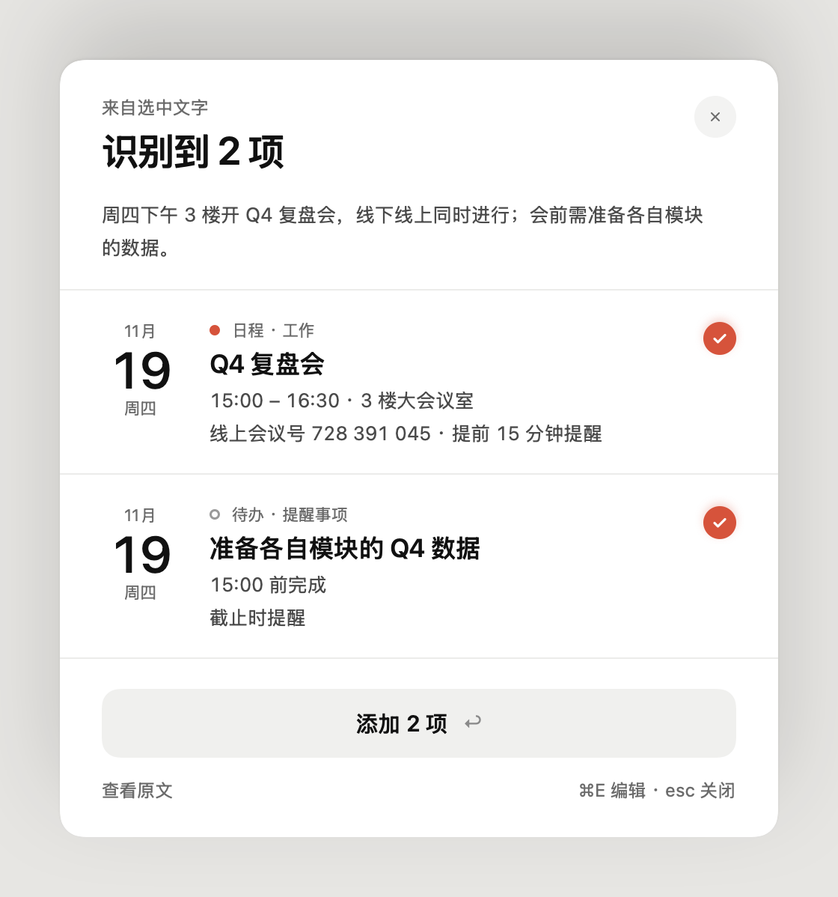
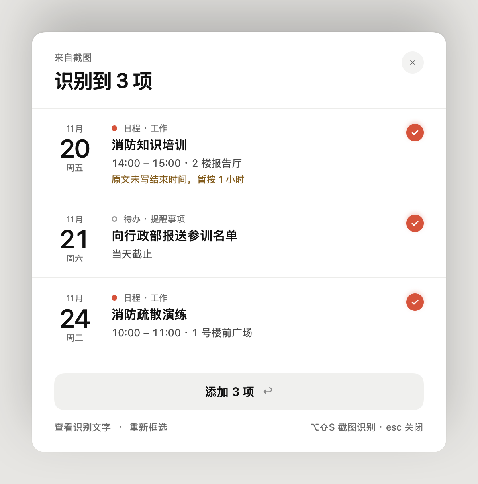
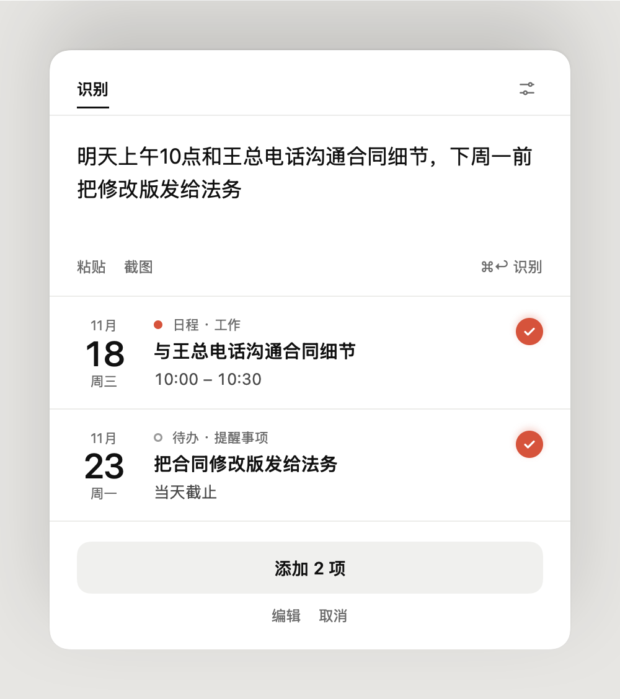
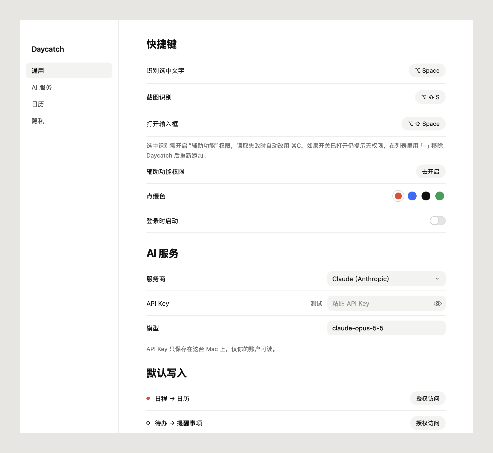

# Daycatch

[English](README.md) · **简体中文**

macOS 菜单栏应用：把文字或截图变成日历日程和提醒事项。选中一段消息、粘贴一段聊天记录，或者框选一块屏幕——Daycatch 用你自己选择的 AI 服务提取时间、地点和任务，先把识别结果摆给你确认，再把确认过的内容一键写入「日历」和「提醒事项」。

<p align="center">
  <a href="docs/promo/daycatch-promo-zh-CN.mp4"></a>
  <br><sub>▶ 50 秒演示 · <a href="docs/promo/daycatch-promo-en.mp4">English version</a></sub>
</p>

<p align="center">
  
</p>

不用再把「周四下午 3 点 Q4 复盘会 3 楼会议室」从微信里复制到两个不同的 App。没有确认之前不会写入任何东西，写错了也能一键撤销。

## 为什么做这个

- **三种入口，同一个确认界面。** 选中文字（`⌥Space`）、截图（`⌥⇧S`）、手动粘贴（`⌥⇧Space`）。
- **决定权在你。** 写入前可以取消勾选、行内编辑。原文没写、由模型推断出来的字段会明确标出，猜测不会被当成事实。
- **一个键写入，一次点击撤销。** `↩` 添加勾选项；随后出现的通知卡片上有「撤销」，只删除刚刚写入的那几条。
- **截图不出本机。** OCR 由 Vision 在本机完成，只有识别出的文字会发给你配置的 AI 服务。
- **自带模型。** Claude、OpenAI、DeepSeek、通义千问，或任何 OpenAI 兼容接口，用自己的 API Key。

## 功能

| | |
|---|---|
| **日程面板** | 点击菜单栏图标，左栏日程、右栏待办，按时间由近到远排列；某一栏为空时只显示另一栏。只读读取「日历」和「提醒事项」。 |
| **选中识别** | `⌥Space` 通过辅助功能读取当前选中的文字，读取失败时回退到模拟 `⌘C`。 |
| **截图识别** | `⌥⇧S` 框选屏幕区域，本机 Vision OCR 后按文字识别。 |
| **手动输入** | `⌥⇧Space` 或日程面板右上角的输入按钮。粘贴文字后 `⌘↩` 识别。 |
| **行内编辑** | `⌘E` 就地修改标题、日期、时间、提醒，以及写入到哪个列表。 |
| **推断标记** | 缺失的结束时间、模糊的「下午」、推断出的地点都会标注，避免把猜测当成原文。 |
| **撤销** | 写入后的通知卡片会删除刚刚创建的日程和待办。 |
| **中英双语界面** | 在「设置 → 通用 → 语言」里切换简体中文 / English，默认跟随系统语言；发给 AI 的提示词也会跟着界面语言走。 |

<p align="center">
  
  
  
</p>

## 环境要求

- macOS 14（Sonoma）或更高
- Xcode 15 或更高
- [XcodeGen](https://github.com/yonaskolb/XcodeGen)：`brew install xcodegen`
- 任一受支持 AI 服务的 API Key

## 安装

```sh
brew trust luckyabner/daycatch                          # Homebrew 要求先信任第三方 tap
brew install --cask luckyabner/daycatch/daycatch
```

也可以按下面的「构建与运行」从源码编译。

## 更新

Daycatch 用 [Sparkle](https://sparkle-project.org) 自动更新：每 24 小时在后台查一次 GitHub Release，发现新版本时右下角会弹一张卡片，点「更新」就下载、校验签名、替换并重启。
也可以随时手动检查：「设置 → 关于 → 检查更新」，或右键菜单栏图标 →「检查更新…」。

界面语言、快捷键等设置和已授予的系统权限在更新后都会保留。发版流程和签名密钥见 [docs/updates.md](docs/updates.md)。

## 构建与运行

```sh
git clone https://github.com/luckyabner/daycatch.git
cd daycatch

make build      # 生成 Daycatch.xcodeproj 并编译 Debug
make test       # 运行单元测试（不联网、不启动 App）
make run        # 编译并启动，菜单栏出现日历图标
make snapshot   # 用示例数据把各界面渲染成 PNG：build/snapshots/
make release VERSION=0.2.0   # 发版：打包 + 签名 + appcast + GitHub Release（见 docs/updates.md）
```

工程文件由 `project.yml` 生成，不要手动修改 `Daycatch.xcodeproj`。

首次启动请打开「设置 → AI 服务」，选择服务商、粘贴 API Key 和模型，点「测试」确认能连通。

> **请用 `make run` 或 `open build/Build/Products/Debug/Daycatch.app` 启动。** 直接在终端运行 `Contents/MacOS/Daycatch` 时，系统会按终端来判断权限。用 Xcode 或 `xcodebuild` 直接编译出来的是 ad-hoc 签名，权限会随每次编译失效；`make build` 会用本地自签名证书重新签名来避免这个问题。

## 使用

| 入口 | 默认快捷键 | 说明 |
|---|---|---|
| 日程面板 | 点击菜单栏图标 | 左栏日程、右栏待办，按时间由近到远填满面板；某一栏为空时只显示另一栏。右上角是输入识别和设置按钮 |
| 选中识别 | `⌥Space` | 读取当前选中的文字，结果显示在鼠标旁的浮动面板 |
| 截图识别 | `⌥⇧S` | 框选屏幕区域，本机 OCR 后识别，图片不上传 |
| 手动输入 | `⌥⇧Space` / 日程面板右上角 | 粘贴文字后按 `⌘↩` 识别 |

结果面板：`↩` 添加勾选项，`⌘E` 行内编辑，`esc` 关闭。右键菜单栏图标可打开设置或退出。快捷键、点缀色、登录时启动都可以在设置里修改。

## 支持的 AI 服务

| 服务商 | 默认地址 | 默认模型 |
|---|---|---|
| Claude（Anthropic） | `https://api.anthropic.com` | `claude-opus-5-5` |
| OpenAI | `https://api.openai.com/v1` | `gpt-5-mini` |
| DeepSeek | `https://api.deepseek.com/v1` | `deepseek-chat` |
| 通义千问 | `https://dashscope.aliyuncs.com/compatible-mode/v1` | `qwen-plus` |
| 自定义 | 任意 OpenAI 兼容地址 | 自行填写 |

Claude 走 Anthropic Messages API，其余服务商走 OpenAI 兼容的 chat completions 接口。地址和模型都可修改，所以本地代理、网关、自建模型也能用。单次输入上限 20,000 字。

<p align="center">
  
</p>

## 权限

| 权限 | 用途 | 何时请求 |
|---|---|---|
| 辅助功能 | 读取选中文字、在读取失败时模拟 `⌘C`，以及在 macOS 15 上可靠捕获 `⌥Space` 等快捷键 | 第一次按 `⌥Space` |
| 屏幕录制 | 截图识别 | 第一次按 `⌥⇧S` |
| 日历 / 提醒事项（完全访问） | 显示菜单栏日程面板、写入事项，撤销时删除 | 第一次点菜单栏图标或第一次点「添加」 |

没有开发者证书。`make build` 会用 `scripts/sign.sh` 生成并使用一个本地自签名证书（存放在项目内的 `.signing/`，不改动登录钥匙串），签名身份固定为「Bundle ID + 证书」，**重新编译后已授予的权限不会失效**。只有删除 `.signing/` 才需要重新授权一次。

## 隐私

- 文字或 OCR 结果只会发送给你配置的 AI 服务，用的是你自己的 Key。没有 Daycatch 服务器，也没有埋点。
- 截图在本机处理，不上传。
- API Key 不放钥匙串（钥匙串会因签名变化反复弹窗），而是存在 `~/Library/Application Support/com.luckyabner.daycatch/credentials.json`，文件权限 `0600`，只有当前用户可读写。
- 除了你确认的添加和撤销，对「日历」「提醒事项」只做只读访问。

## 代码结构

```
Daycatch/
  App/          入口、AppController（串起各流程）、浮动面板、菜单栏图标、设置窗口
  Agenda/       日程面板读取（EventKit 只读）、两栏数据状态
  UI/           设计 Token、结果面板 ①②、菜单栏弹窗 ③、日程面板、通知卡片、设置页 ④
  AI/           AIProvider 协议、Claude / OpenAI 兼容实现、提示词、ExtractionService
  Model/        事项模型、AI 返回 JSON 的解析、日期解析、展示文字格式化
  Recognition/  选中文字读取（AX + ⌘C 回退）、截图 + Vision OCR、权限
  Calendar/     EventKit 写入与撤销
  Settings/     UserDefaults 设置、API Key 文件存储
  Hotkeys/      全局快捷键（Carbon + CGEventTap）
DaycatchTests/  单元测试（假 AI 响应、假 HTTP）
Spikes/         系统 API 的最小验证脚本
docs/           截图、宣传片
```

## 开发

```sh
make test       # 单元测试，不联网、不启动 App
make snapshot   # 重新生成截图到 build/snapshots/
```

发版前先过一遍 [notes/checklist.md](notes/checklist.md)（发布后必查项 + 出问题时怎么收场）。

测试目标直接把纯逻辑源码（`Model`、`AI`、`Shortcut`、`CredentialStore`）编进测试包，不挂宿主 App，所以测试时不会启动菜单栏应用；AI 调用在 HTTP 层被替换成假响应，整套测试离线可跑。

## 已知限制

- 界面目前**只有简体中文**。欢迎本地化 PR。
- 仅支持 macOS，没有 iOS 版本。
- 每个服务商一个 API Key，以明文文件存在本机（见「隐私」）。
- 没有公证，用的是项目内自签名证书：首次安装请用 Homebrew（见「安装」），不要从浏览器下压缩包。

## 参与贡献

欢迎提 Issue 和 PR。比修 bug 更大的改动，请先开 Issue 对齐方向。提交 PR 前请跑一遍 `make test` 和 `make build`。

## 许可证

[MIT](LICENSE) © 2026 luckyabner

Daycatch 可自由使用、修改和分发。发布修改版时请保留版权声明和许可证文本。
